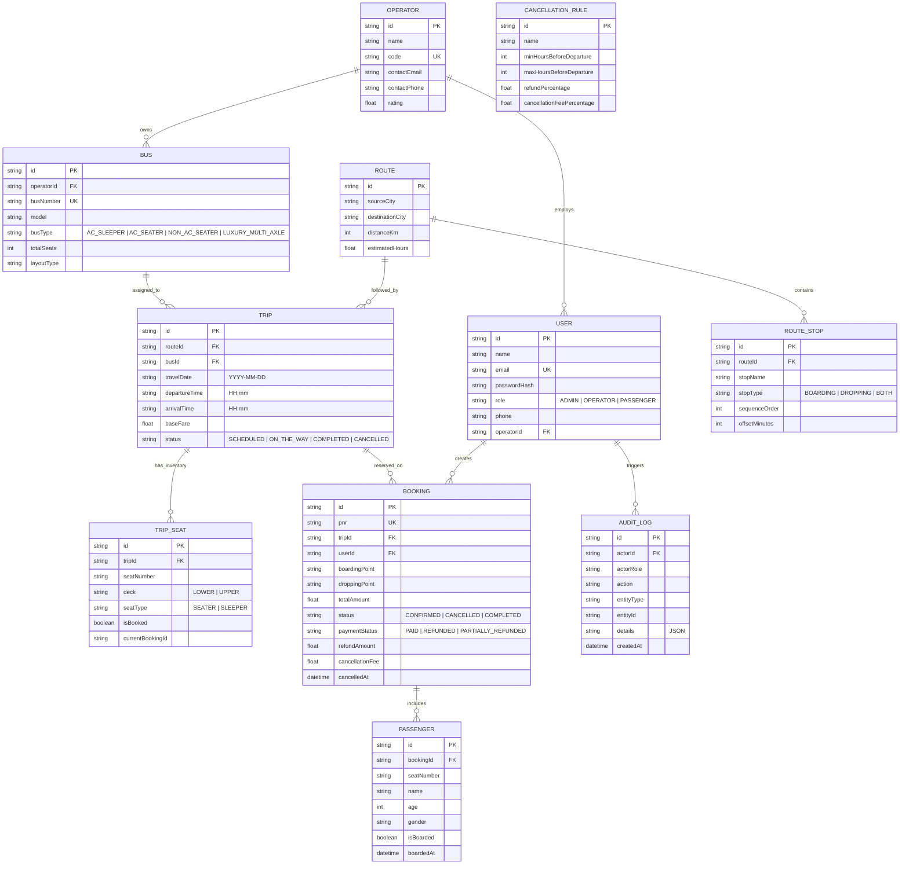

# Algions Bus Booking Management System

> **Full-Stack Web Development | Advanced Individual Project Assessment**  
> **Company / Evaluator**: ALGIONS AI LABS PRIVATE LIMITED  
> **Assigned Domain**: Bus Booking Management System  
> **Tech Stack**: React 18, Node.js, Express, TypeScript, Prisma ORM, SQLite, Tailwind CSS, Jest, Supertest, Swagger OpenAPI 3.0

---

## 🌟 Executive Summary

The **Algions Bus Booking Management System** is a responsive, database-backed enterprise travel management application supporting end-to-end operational staff and passenger journeys. Built as a maintainable modular monolith, it enforces server-side role-based access control (RBAC), ACID-compliant transactional seat integrity to prevent double booking under high concurrency, a dynamic configurable cancellation rules engine with simulated refunds, live passenger boarding check-ins, and automated mathematical passenger manifest reconciliation.

The system features real-world Indian intercity bus operators (**VRL Travels, KSRTC Ambari Utsav & Airavat, Orange Tours, SRS Travels, IntrCity SmartBus, Zingbus Electric, Royal Express**), multi-axle luxury fleets (Volvo 9600 Sleeper, Scania Metrolink, Mercedes Super Cruiser, BharatBenz), and major transit corridors.

---

## 📋 Acceptance Criteria Verification

| # | Acceptance Criteria | Implementation & Defense Mechanism | Automated Test Evidence |
|---|---------------------|-------------------------------------|:------------------------:|
| **1** | **Search valid trip & book available seat** | Real-time seat inventory calculation, origin/destination/date search, filters (AC Sleeper / Seater / Non-AC, price range, departure window: Morning/Afternoon/Evening/Night, sorting by cheapest/fastest/rating). Interactive bus seat layout (2+2 seater and 2+1 sleeper deck). | **PASSED** (`tests/api.test.ts`) |
| **2** | **Two users cannot confirm the same seat on one trip** | **ACID Database Transaction (`prisma.$transaction`)** + optimistic locking condition (`where: { isBooked: false }`) + composite schema constraint (`@@unique([tripId, seatNumber])`). If two users submit simultaneously, exactly one succeeds (HTTP 201) and one is safely rejected (HTTP 409 Conflict). | **PASSED** (Concurrently tested with `Promise.all` in test suite) |
| **3** | **PNR includes correct passenger, route, date and seat details** | Unique PNR generation (`ALG-XXXXXX`), digital boarding pass, printable e-ticket modal, QR/barcode simulation, passenger manifest details. | **PASSED** (`tests/api.test.ts`) |
| **4** | **Cancellation changes seat availability and refund status according to rule** | Configurable tiered cancellation policy engine (e.g., >24h = 90% refund, 12–24h = 50%, <12h = 0%). Atomic seat release back to available inventory and booking status transition to `CANCELLED`. | **PASSED** (`tests/api.test.ts`) |
| **5** | **Operator manifest and occupancy summaries reconcile with confirmed tickets** | Conductor manifest sorted by seat number with live passenger boarding check-in; automated mathematical reconciliation: $\text{Manifest Count} = \text{Booked Seats} = (\text{Total Capacity} - \text{Available Seats})$. Verified reconciliation badge in operator portal. | **PASSED** (`tests/api.test.ts`) |

---

## 🏛️ System Architecture

```
[ Frontend: React 18 + Vite + Tailwind CSS ]
                     │  HTTP / REST (JWT Bearer Auth)
                     ▼
┌─────────────────────────────────────────────────────────────┐
│                 Node.js / Express Backend                   │
│                                                             │
│  [ Middleware Layer ]                                       │
│   ├── JWT Authentication Guard                              │
│   ├── Role-Based Access Control (RBAC: ADMIN/OPERATOR/USER) │
│   ├── Zod Input Request Validation                          │
│   └── Centralized Error Handling (HTTP 400/401/403/409/500) │
│                                                             │
│  [ Service / Domain Layer ]                                 │
│   ├── TripService (Search, filter, seat inventory, sorting) │
│   ├── BookingService (ACID seat lock, PNR generation)       │
│   ├── CancellationService (Tiered refund policy engine)     │
│   ├── ReportService (Manifest & Occupancy Reconciliation)   │
│   └── OperatorService (Fleet, Routes, Stops, Trip dispatch) │
│                                                             │
│  [ Persistence Layer: Prisma ORM ]                          │
│   ├── Transactions (prisma.$transaction)                    │
│   ├── Composite Unique Constraints                          │
│   └── Audit Trail Logger (AuditLog)                         │
└─────────────────────────────┬───────────────────────────────┘
                              ▼
                     [ SQLite Database ]
                     (dev.db - Zero Setup)
```

---

## 🗄️ Database Schema & ER Diagram



---

## 🔑 Demo Accounts & Credentials

The system comes pre-seeded with verified test accounts across all roles:

| Role | Email | Password | Permissions & Capabilities |
|------|-------|----------|----------------------------|
| **Admin** | `admin@algions.com` | `Password123!` | Full system access: fleet setup, route management, cancellation policy rule editing, system-wide audit logs. |
| **Operator** | `operator@royalbus.com` | `Password123!` | Royal Express operator portal: trip dispatch, route occupancy analytics, passenger manifest export & live boarding check-ins. |
| **Operator** | `operator@vrlbus.com` | `Password123!` | VRL Travels fleet operator access. |
| **Passenger** | `passenger@example.com` | `Password123!` | Search trips, select seats, book tickets, view e-tickets, cancel tickets with live refund calculation. |

> **💡 Quick Demo Role Switcher**: The navigation bar includes one-click role switching pills ("Passenger", "Operator", "Admin") allowing immediate testing without manual re-login.

---

## 🚀 Quickstart & Setup Guide

### Prerequisites
- **Node.js** (v18.x, v20.x, or v22.x)
- **npm** (v9.x or v10.x)
- No external database installation needed (uses embedded SQLite).

### One-Command Setup
From the repository root:
```bash
npm run setup
```
*(This installs server dependencies, client dependencies, synchronizes the Prisma SQLite database, and populates comprehensive seed data).*

### Running in Development
Start backend and frontend concurrently:
```bash
# Terminal 1: Backend API Server (Port 5000)
npm run dev:server

# Terminal 2: React Frontend (Port 5173)
npm run dev:client
```
Open **`http://localhost:5173`** in your browser.

### Running in Production Mode (Single Port)
```bash
npm run build
npm start
```
Open **`http://localhost:5000`** in your browser (both the React client, REST API, and Swagger Docs run on port 5000).

---

## 🧪 Automated Test Suite

Run the automated test suite verifying all 5 acceptance criteria:
```bash
npm test
```

### Test Suite Execution Output
```
PASS tests/api.test.ts
  Bus Booking Management System - Acceptance & Integration Tests
    1. Trip Search & Discovery
      √ should search trips by origin and destination and return real-time available seat inventory
      √ should support sorting trips by price ascending
      √ should retrieve full trip details with seat layout map
    2. Seat Booking, PNR Validation & Concurrency Protection
      √ CRITICAL CONCURRENCY TEST: Two users attempting to book the SAME seat simultaneously must result in 1 confirmation and 1 conflict rejection (HTTP 409)
      √ should reject a subsequent booking request for an already booked seat
      √ Acceptance Criteria 3: PNR ticket includes correct passenger, route, date and seat details
    3. Cancellation Rules, Refund Simulation & Seat Recovery
      √ should preview refund breakdown according to hours before departure
      √ Acceptance Criteria 4: Cancellation changes status to CANCELLED, processes refund, and restores seat to available
    4. Operator Manifest & Occupancy Reconciliation
      √ Acceptance Criteria 5: Manifest and occupancy summaries reconcile with confirmed tickets
      √ should allow conductor/operator to toggle passenger boarding check-in status
      √ should retrieve operator dashboard metrics
    5. Server-Side RBAC Enforcement
      √ should reject a passenger attempting to create a trip with 403 Forbidden
      √ should reject unauthenticated requests to protected endpoints with 401 Unauthorized

Test Suites: 1 passed, 1 total
Tests:       13 passed, 13 total
Time:        ~12 s
```

---

## 📚 API Documentation (Swagger / OpenAPI 3.0)

Interactive OpenAPI Swagger UI is embedded directly into the backend server:
- **Interactive UI**: [http://localhost:5000/api-docs](http://localhost:5000/api-docs)

### Primary Endpoints Overview

| Method | Endpoint | Description | Role Required |
|--------|----------|-------------|---------------|
| `POST` | `/api/auth/register` | Register new user account | Public |
| `POST` | `/api/auth/login` | Login and obtain JWT token | Public |
| `GET` | `/api/auth/me` | Fetch active user profile | Authenticated |
| `GET` | `/api/trips/search` | Search trips with origin, destination, date, type, window, and sort filters | Public |
| `GET` | `/api/trips/:id` | Fetch trip details & visual seat map | Public |
| `POST` | `/api/trips` | Schedule new trip | `ADMIN`, `OPERATOR` |
| `POST` | `/api/bookings` | Atomically reserve seats & generate unique PNR | `PASSENGER`, `ADMIN` |
| `GET` | `/api/bookings/my-bookings` | Retrieve user booking history | Authenticated |
| `GET` | `/api/bookings/pnr/:pnr` | Retrieve booking details by PNR | Public |
| `GET` | `/api/cancellations/preview/:bookingId` | Preview refund breakdown by hours before departure | Authenticated |
| `POST` | `/api/cancellations/:bookingId` | Cancel booking & release seats back to inventory | Authenticated |
| `GET` | `/api/reports/manifest/:tripId` | Get reconciled passenger manifest | `ADMIN`, `OPERATOR` |
| `PATCH`| `/api/reports/checkin/:passengerId`| Toggle passenger boarding check-in | `ADMIN`, `OPERATOR` |
| `GET` | `/api/reports/dashboard` | Get operator KPIs & seat occupancy summary | `ADMIN`, `OPERATOR` |
| `GET` | `/api/reports/audit-logs` | Query system audit trail | `ADMIN` |

---

## 🔒 Concurrency & Data Integrity Design

1. **Race Condition Protection**:
   When multiple passengers attempt to reserve the same seat simultaneously:
   - The transaction queries `TripSeat` using an atomic predicate `where: { tripId, seatNumber, isBooked: false }`.
   - If `updateResult.count` does not equal the requested seat count, the transaction aborts and returns an HTTP `409 Conflict`.
   - Database-level unique constraint `@@unique([tripId, seatNumber])` prevents duplicate seat generation.
2. **ACID Transaction Isolation**:
   Booking creation, passenger record insertion, seat status updates, and audit log writes happen atomically inside `prisma.$transaction`.
3. **Idempotency**:
   Cancellation requests check existing booking status. If already cancelled, an idempotent rejection (HTTP `400`) prevents duplicate refund processing.

---

## ⚠️ Assumptions and Limitations

1. **Payment Gateway**: Payment processing is simulated (`paymentStatus: PAID`, `refundStatus: REFUNDED`) to avoid external paid gateway dependencies.
2. **Database Engine**: Uses SQLite for zero-setup, self-contained reproducibility. Prisma can be swapped to PostgreSQL by changing the `provider` in `schema.prisma`.
3. **SMS / Email Notifications**: Real-world integrations (Twilio, SendGrid) are represented in the audit log and simulated ticket view.
